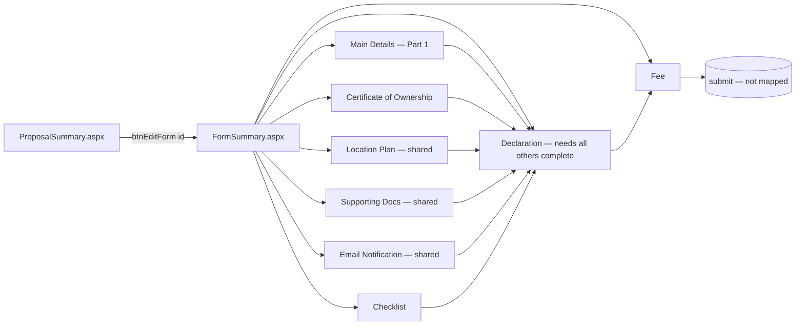

# ePlanning.scot — Planning Permission form: full flow map

Mapped live on 2026-11-27 against a test draft, by stepping through
every page and testing each branching answer. This is the reference for building the desktop
Agent's `automation/planning_permission/` module, next to `automation/householder/`.

> **Status:** Mapped live **all the way to the Fee step**. Main Details, the Certificate of Ownership
> (Certificates A, B, C and E each run to 100%), Checklist and **Declaration** were completed on the test
> draft, and every Form Summary section shows ✔ except **Fee**. Fee/payment is where the Agent stops:
> the user checks the application, enters or pays the fee, and submits manually. Location Plan,
> Supporting Documentation and Email Notification are shared with the other forms, so reuse the
> existing code (§P2.4). Nothing was uploaded, paid or submitted.

---

## 0. Conventions used in this document

| Shorthand | Meaning |
|---|---|
| `~` | ID prefix **`MainContent_PlanningPermissionWizard_`** (e.g. `~btnNextWelcome` = `MainContent_PlanningPermissionWizard_btnNextWelcome`) |
| `[x%]` | The "Progress: x%" banner on that page. It is the most reliable way to tell which page you are on, because every page shares one URL. |
| **★** | Required field (`*` on the page, or enforced by the server) |
| ⤷ | Conditional page: shown only when the stated answer was given |

**URL:** every Main Details page posts back to the same URL,
`https://www.eplanning.scot/ePlanningClient/CustomPages/Applications/PlanningPermissionMainDetails.aspx`.
It is an ASP.NET `<asp:Wizard>`, so the URL never changes. Detect the page from the progress % or the
step's own `btnNext…` ID, which is unique per page.

### Buttons present on every page

Every step has four buttons. Their IDs follow one pattern, `~btn{Action}{StepName}`:

| Action | Value text | Notes |
|---|---|---|
| `Save` | "Save and Exit" / "Save And Exit" | Saves, then leaves to the Form Summary |
| `Clear` | "Clear" / "Clear Page" | Blanks the page's fields |
| `Previous` | "Previous" | |
| `Next` | "Next" | **Use this one.** It is the step-specific ID |

Each page also has **hidden** generic wizard buttons:
`~StepNavigationTemplateContainerID_StepPreviousButton` / `~StepNavigationTemplateContainerID_StepNextButton`
(on the Welcome page, `~StartNavigationTemplateContainerID_StartNextButton`; on Review,
`~FinishNavigationTemplateContainerID_FinishButton`). They are `display:none`. **Do not click them**;
use the step-specific `~btnNext{Step}`.

### Validation behaviour (all pages)
* A missing required answer re-renders the **same** page, with a banner
  *"An issue which requires your attention has occurred on this page!"* and, next to the field,
  *"This field is required"*.
* Some checks are client-side (ASP.NET validators). Then no postback happens at all, so an
  automation waiting for page load will hang. Always use a timeout, then read the error spans.
* **No radio button on this form auto-posts back.** Conditional pages appear only after **Next**.
* Radios are visually styled: the `<input>` itself may report zero size. Click the input by ID
  (or its `<label for=…>`); don't rely on the input being "visible".

---

## 1. Flow overview (Full Planning Permission)

```mermaid
flowchart TD
  W[0% Welcome] --> T[3% Type of Application]
  T -->|Further / AMSC| TR[6% Earlier application ref + date]
  T -->|Full / PPP| D
  TR --> D[8% Description + Temporary?]
  D -->|Temporary = Yes| D1[11% How long / why]
  D -->|No| D2
  D1 --> D2[14% Change of use taken place? / Works started?]
  D2 -->|Started or Completed| D3[17% Date + reason for early works]
  D2 -->|Not started| U
  D3 --> U[19% Applicant or Agent? Use account details?]
  U -->|Agent| AG[22% Agent Details]
  U -->|Applicant| AP
  AG --> AP[25% Applicant Details]
  AP --> PA[28% Pre-application discussion?]
  PA -->|Yes| PA1[31% Feedback repeater]
  PA -->|No| SA
  PA1 --> SA[33% Site Area]
  SA --> EU[36% Existing Use]
  EU --> AC[39% New/altered vehicle access?]
  AC --> AC1[42% Changes to public paths? — ALWAYS]
  AC1 -->|Full / Further / AMSC| AC2[44% Parking spaces — ALWAYS]
  AC1 -->|PPP| WS
  AC2 --> WS[47% New/altered water or drainage?]
  WS -->|No| SU
  WS -->|Yes| W1[50% Public drainage?]
  W1 -->|Yes public / N/A| SU
  W1 -->|No private| W2[53% Which private arrangement?]
  W2 -->|Septic tank| W3[56% Discharge to where?]
  W2 -->|Treatment plant / Other| W4
  W3 --> W4[58% Explain private drainage]
  W4 --> SU[61% SUDS?]
  SU --> WM[64% Public water supply?]
  WM --> FR[67% Known flood risk? / Increase flood risk?]
  FR -->|Increase = Yes| FR1[69% Describe increased risk]
  FR -->|otherwise| TREES
  FR1 --> TREES[72% Trees?]
  TREES -->|Full / AMSC| WA[75% Waste storage?]
  TREES -->|PPP / Further| FL
  WA --> WA1[78% Waste details — ALWAYS]
  WA1 --> RU[81% New houses/flats?]
  RU -->|Yes| RU1[83% Number of units]
  RU -->|No| FLchk{type}
  RU1 --> FLchk
  FLchk -->|Full| FL[86% Non-residential floorspace?]
  FLchk -->|AMSC| S3
  FL -->|Yes| FL1[89% Floorspace repeater]
  FL -->|No| S3
  FL1 --> S3[92% Schedule 3 development?]
  S3 --> PS[94% Planning staff / member interest?]
  PS -->|Yes| PS1[97% Interest details]
  PS -->|No| RV
  PS1 --> RV[100% Review → Next to Form Summary]
```

---

## 2. Page-by-page reference

### [0%] Welcome
Text: shows the reference number, plus a note that the form is public. No inputs.

| Element | ID |
|---|---|
| Previous | `~btnPreviousWelcome` |
| **Next** | `~btnNextWelcome` |

### [3%] Type of Application ★
*"What is this application for? Please select one of the following:"*

| Option | ID |
|---|---|
| Application for Planning Permission (incl. changes of use and surface mineral working) | `~rbAppForPlanningPermission` |
| Application for Planning Permission in Principle | `~rbAppForPlanningPermissionPrinciple` |
| Further Application (renewal, modification/variation/removal of a condition, etc.) | `~rbFurtherApplication` |
| Application for Approval of Matters specified in conditions | `~rbAppForApprovalOfMatters` |

Buttons: `~btnSaveTypeOfApplication`, `~btnClearTypeOfApplication`, `~btnPreviousTypeOfApplication`, **`~btnNextTypeOfApplication`**.
None selected → *"This field is required"*.
**The choice changes which later pages appear.** See [§3 Type matrix](#3-application-type-matrix).

### ⤷ [6%] Type of Application (continued): *Further Application* and *AMSC* only
| Field | ID | Notes |
|---|---|---|
| Application Reference No ★ | `~txtAppRef` | Reference of the earlier consent |
| Date (dd/mm/yyyy) ★ | **`txtAppDate`** | ⚠ **No `MainContent_` prefix.** Date-picker text box. Type the date string straight in. |

Buttons: `~btn{Save|Clear|Previous|Next}TypeOfApplicationCont1`.

### [8%] Description of Proposal
| Field | ID | Notes |
|---|---|---|
| Describe the proposal including any change of use ★ | `~txtProposalDescription` | textarea, max 500 chars |
| Is this a temporary permission? ★ | `~rbTemporaryYes` / `~rbTemporaryNo` | group `TemporaryAnswerGroup` |

Buttons: `~btn{…}DescriptionOfProposal`.
Routing: **Yes** → [11%]; **No** → [14%].

### ⤷ [11%] Description continued: Temporary = Yes
| Field | ID |
|---|---|
| How long is permission required for, and why? ★ (max 500) | `~txtPermissionReason` |

Buttons: `~btn{…}DescriptionOfProposalCont1`.

### [14%] Description continued
| Question | Options / IDs |
|---|---|
| If a change of use is included, has it already taken place? ★ (answer No if no change of use) | `~rbChangeOfUseYes` / `~rbChangeOfUseNo` (group `ChangeOfUseGroup`) |
| Have the works already been started or completed? ★ | `~rbWorkStartedNo` / `~rbWorkStartedYesStarted` / `~rbWorkStartedYesCompleted` (group `WorkStatusGroup`) |

Buttons: `~btn{…}DescriptionOfProposalCont2`.
Routing: Works **Started** or **Completed** → [17%]; **No** → [19%]. Change-of-use = Yes adds **no** page.

### ⤷ [17%] Description continued: Works started or completed
| Field | ID | Notes |
|---|---|---|
| Date of completion, or the start date if not completed (dd/mm/yyyy) ★ | **`txtCompletionDate`** | ⚠ **No prefix.** Name `ctl00$MainContent$PlanningPermissionWizard$txtCompletionDate`. jQuery date-picker (month/year dropdowns attached). |
| Why has work taken place before applying? ★ (max 500) | `~txtReasonsWorkInAdvance` | |

Buttons: `~btn{…}DescriptionOfProposalCont3`.

### [19%] Applicant or Agent Details
| Question | Options / IDs |
|---|---|
| Are you an Applicant, or an agent? ★ | `~rbAppealant` (Applicant, ⚠ spelled "Appealant") / `~rbAgent` (group `UserTypeGroup`) |
| Do you want to use your registered account details? ★ | `~rbAccountDetailsYes` / `~rbAccountDetailsNo` (group `UseAccountDetailsGroup`) |

Buttons: `~btnSaveTypeOfUserStep`, `~btnClearTypeOfUserStep` ("Clear Page"), `~btnPreviousTypeOfUserStep`, **`~btnNextTypeOfUserStep`**.
Routing:
* **Agent** → [22%] Agent Details → [25%] Applicant Details.
* **Applicant** → skips straight to [25%] Applicant Details.
* **Account details = Yes** pre-fills the page for whoever you are: the Agent page when you're the Agent, the **Applicant** page when you're the Applicant (⚠ this **overwrites** values already typed there).
* **Account details = No** does **not** clear values saved earlier.

### ⤷ [22%] Agent Details: Agent only
Pre-filled from the account when "use account details" = Yes. Prefix `~AgentDetails_`.

| Field | ID | Req |
|---|---|---|
| Company/Organisation | `~AgentDetails_txtAgentCompany` | |
| Ref. Number | `~AgentDetails_txtAgentRefNo` | |
| First Name | `~AgentDetails_txtAgentFirstName` | ★ |
| Last Name | `~AgentDetails_txtAgentSurname` | ★ |
| Building Name | `~AgentDetails_txtAgentBuildingName` | ★ name **or** number |
| Building Number | `~AgentDetails_txtAgentBuildingNo` | ★ name **or** number |
| Address 1 (Street) | `~AgentDetails_txtAgentAddress1` | ★ |
| Address 2 | `~AgentDetails_txtAgentAddress2` | |
| Town/City | `~AgentDetails_txtAgentTown` | ★ |
| Country | `~AgentDetails_txtAgentCountry` | ★ |
| Postcode | `~AgentDetails_txtAgentPostcode` | |
| Telephone Number | `~AgentDetails_txtAgentTelNo` | ★ |
| Extension Number | `~AgentDetails_txtAgentExtensionNo` | numeric, **< 6 digits** |
| Mobile Number | `~AgentDetails_txtAgentMobileNo` | |
| Fax Number | `~AgentDetails_txtAgentFaxNo` | |
| Email Address | `~AgentDetails_txtAgentEmailAddress` | ★ |
| Individual / Organisation ★ | `~AgentDetails_rblIndividualOrOrganisation_0` (Individual) / `_1` (Organisation/Corporate entity) | ⚠ **Not pre-filled** by account details. Must be clicked. |

Buttons: `~btn{Save|Clear|Previous|Next}AgentDetails`.
Errors seen: *"Is the applicant an individual or an organisation/corporate entity? *: This field is required"* (the wording says "applicant" even on the Agent page);
*"Extension Number: Please enter a valid extension number, this must be less that 6 digits"*.

### [25%] Applicant Details
⚠ The prefix is spelled **`~AppelantDetails_`**, and the buttons are spelled **`…AppellantDetails`**.

| Field | ID | Req |
|---|---|---|
| Title | `~AppelantDetails_ddlApplicantTitle`: options `Please Select One`, `Mr`, `Mrs`, `Miss`, `Ms`, `Other` (value = text) | ★ |
| Other Title | `~AppelantDetails_txtApplicantOtherTitle` | ★ only if Title = Other. ⚠ **Must be empty otherwise:** *"Please select 'Other' from the title list"* |
| First Name | `~AppelantDetails_txtApplicantFirstName` | ★ |
| Last Name | `~AppelantDetails_txtApplicantLastName` | ★ |
| Company/Organisation | `~AppelantDetails_txtApplicantCompany` | |
| Building Name | `~AppelantDetails_txtApplicantBuildingName` | ★ name **or** number |
| Building Number | `~AppelantDetails_txtApplicantBuildingNo` | ★ name **or** number |
| Address 1 (Street) | `~AppelantDetails_txtApplicantAddress1` | ★ |
| Address 2 | `~AppelantDetails_txtApplicantAddress2` | |
| Town/City | `~AppelantDetails_txtApplicantTown` | ★ |
| Country | `~AppelantDetails_txtApplicantCountry` | ★ |
| Postcode | `~AppelantDetails_txtApplicantPostcode` | |
| Telephone | `~AppelantDetails_txtApplicantTelephoneNumber` | |
| Extension | `~AppelantDetails_txtApplicantExtensionNumber` | |
| Mobile | `~AppelantDetails_txtApplicantMobileNumber` | |
| Fax | `~AppelantDetails_txtApplicantFaxNumber` | |
| Email Address | `~AppelantDetails_txtApplicantEmailAddr` | ★ **server-enforced** (*"Email Address is required."*) though there's no `*` on the page |

There is **no** Individual/Organisation radio on the Applicant page.
Buttons: `~btnSaveAppellantDetails`, `~btnClearAppellantDetails`, `~btnPreviousAppellantDetails`, **`~btnNextAppellantDetails`**.
Errors on an empty submit: Title, Email, Building Name/Number, Address 1, Town, Country.
Note: there is **no site-address step** in this wizard. The site location is set when the proposal is created.

### [28%] Pre-Application Discussion
| Question | IDs |
|---|---|
| Have you discussed your proposal with the planning authority? ★ | `~rbDisccussedYes` / `~rbDisccussedNo` (⚠ "Disccussed", double c; group `DiscussedProposalGroup`) |

Buttons: `~btn{…}PreApplicationDiscussion`. **Yes** → [31%]; **No** → [33%].

### ⤷ [31%] Pre-Application Discussion continued: Discussed = Yes
A **repeater** with a pager, "1/1". You can add several feedback records. Prefix `~PreApplicationDiscussion1_`.

| Element | ID | Notes |
|---|---|---|
| Pager | `_btnFirst` (<<), `_btnPrev` (<), `_btnNext` (>), `_btnLast` (>>) | |
| Add another record | `_btnAdd` | |
| Remove the current record | `_btnRemove` | |
| Feedback format ★ (checkboxes, pick any) | `_cbMeeting`, `_cbTelephone`, `_cbLetter`, `_cbEmail` | |
| Feedback description + officer name + processing agreement ★ (max 500) | `_tbDescription` | textarea |
| Officer title | `_ddlTitle`: `Please Select One`, `1`=Mr, `2`=Mrs, `3`=Miss, `4`=Ms, `5`=Other | ⚠ **numeric values** |
| Other title | `_edtOtherTitle` | |
| Officer first / last name | `_edtFirstName` / `_edtLastName` | |
| Correspondence reference number | `_edtReference` | |
| Date (dd/mm/yyyy) | **`edtDatePreApp`** | ⚠ **No prefix.** Date-picker |

Page buttons: `~btn{Save|Clear|Previous|Next}PreApplicationDiscussionCont` (not prefixed `PreApplicationDiscussion1_`).

### [33%] Site Area
| Field | ID |
|---|---|
| Site area (number) | `~txtSiteArea` |
| Measurement type | `~rbMeasurementTypeHa` (hectares) / `~rbMeasurementTypeSqM` (sq m) |

Buttons: `~btn{…}SiteArea`.

### [36%] Existing Use
| Field | ID |
|---|---|
| Current or most recent use ★ (max 500) | `~txtCurrentUse` |

Buttons: `~btn{…}ExistingUse`.

### [39%] Access and Parking
| Question | IDs |
|---|---|
| New or altered vehicle access to/from a public road? ★ | `~rbVehicleAccessYes` / `~rbVehicleAccessNo` |

Buttons: `~btn{…}AccessAndParking`. Either answer → [42%]. Yes only adds a "show it on drawings" note.

### [42%] Access and Parking continued: **always shown**
| Question | IDs |
|---|---|
| Changes to public paths, rights of way or public access? ★ | `~rbChangesToPublicPathsYes` / `~rbChangesToPublicPathsNo` |

Buttons: `~btn{…}AccessAndParkingCont1`.

### [44%] Access and Parking continued: **always shown** (Full, Further, AMSC; *not* PPP)
| Field | ID |
|---|---|
| Parking spaces that currently exist on the site | `~txtVehicleParkingSpacesCurrently` |
| Parking spaces proposed | `~txtVehicleParkingSpacesProposed` |

Buttons: `~btn{…}AccessAndParkingCont2`.

### [47%] Water Supply and Drainage Arrangements
| Question | IDs |
|---|---|
| New or altered water supply or drainage? ★ | `~rbNewOrAlteredWaterSupplyYes` / `~rbNewOrAlteredWaterSupplyNo` |

Buttons: `~btn{…}WaterSupply`. **Yes** → [50%]; **No** → [61%] (skips 50–58).

### ⤷ [50%] Water continued (Cont1): WaterSupply = Yes
| Question | IDs |
|---|---|
| Connect to the public drainage network? ★ | `~rbConnectToPublicDrainageYes` (public) / `~rbConnectToPublicDrainageNo` (private arrangements) / `~rbConnectToPublicDrainageNA` (water supply only) |

Buttons: `~btn{…}WaterSupplyCont1`. **No (private)** → [53%]; **Yes** or **N/A** → [61%].

### ⤷ [53%] Water continued (Cont2): private drainage
| Question | IDs |
|---|---|
| What private arrangements? ★ | `~rbNewAltered` (new/altered septic tank) / `~rbTreatement` (⚠ sic; package treatment plant / passive treatment) / `~rbOtherPrivateDrainage` (chemical or composting toilets, etc.) |

Buttons: `~btn{…}WaterSupplyCont2`. **Septic tank** → [56%]; **Treatment** or **Other** → [58%].

### ⤷ [56%] Water continued (Cont3): septic tank
| Question | IDs |
|---|---|
| Where will the septic tank discharge? ★ | `~rbDischargeToLand` (soakaway) / `~rbDischargeToWatercourse` (incl. partial soakaway) / `~rbDischargeToCoastal` |

Buttons: `~btn{…}WaterSupplyCont3`.

### ⤷ [58%] Water continued (Cont4): any private drainage
| Field | ID |
|---|---|
| Explain the private drainage arrangements ★ (max 500) | `~txtPrivateDrainageArrangements` |

Buttons: `~btn{…}WaterSupplyCont4`.
⚠ Switching drainage back to public or N/A **clears this text on the server**.

### [61%] Water continued (Cont5): **always shown**
| Question | IDs |
|---|---|
| Provision for sustainable drainage of surface water (SUDS)? ★ | `~rbSustainableDrainageYes` / `~rbSustainableDrainageNo` (No only shows a legal warning) |

Buttons: `~btn{…}WaterSupplyCont5`.

### [64%] Water continued (Cont6): **always shown**
| Question | IDs |
|---|---|
| Connect to the public water supply? ★ | `~rbConnectToWaterSupplyYes` / `~rbConnectToWaterSuppplyNo` (⚠ **triple p**; private supply) / `~rbConnectToWaterSuppplyNA` (no connection required) |

Buttons: `~btn{…}WaterSupplyCont6`. Every answer → [67%].

### [67%] Assessment of Flood Risk
| Question | IDs |
|---|---|
| Is the site in an area of known flood risk? ★ | `~rbKnownFloodRiskYes` / `~rbKnownFloodRiskNo` / `~rbKnownFloodRiskDontKnow` |
| Might the proposal increase flood risk elsewhere? ★ | `~rbIncreaseFloodRiskYes` / `~rbIncreaseFloodRiskNo` / `~rbIncreaseFloodRiskDontKnow` |

Buttons: `~btn{…}AssessmentOfFloodRisk`. Only **Increase = Yes** → [69%]; otherwise → [72%].

### ⤷ [69%] Flood continued: Increase = Yes
| Field | ID |
|---|---|
| How might flood risk increase elsewhere? (max 500) | `~txtFloodingIncreaseDescription` |

Buttons: `~btn{…}AssessmentOfFloodRiskCont`.

### [72%] Trees
| Question | IDs |
|---|---|
| Trees on or next to the site? ★ | `~rbTreesYes` / `~rbTreesNo` (Yes only adds a note: mark them on drawings) |

Buttons: `~btn{…}Trees`.

### [75%] Waste Storage and Collection (Full and AMSC only)
| Question | IDs |
|---|---|
| Do the plans include waste and recycling storage areas? | `~rbStoreWasteYes` / `~rbStoreWasteNo` |

Buttons: `~btn{…}WasteStorage`.

### [78%] Waste continued: **always shown after 75%**
| Field | ID |
|---|---|
| Further details ★ (max 500) | `~txtWasteCollectionDetials` (⚠ "Detials") |

The label depends on the answer at 75%: Yes → *"…plans incorporate areas… provide further details and illustrate on plans"*; No → *"…plans do not incorporate…"*. **Required either way.**
Buttons: `~btn{…}WasteStorageCont`.

### [81%] Residential Units Including Conversion (Full and AMSC only)
| Question | IDs |
|---|---|
| New or additional houses and/or flats? ★ | `~rbAdditionalHousesYes` / `~rbAdditionalHousesNo` |

Buttons: `~btn{…}ResidentialUnits`. **Yes** → [83%].

### ⤷ [83%] Residential continued: Yes
| Field | ID |
|---|---|
| Total units proposed ★ | `~txtUnitsProposed` |

Buttons: `~btn{…}ResidentialUnitsCont`.

### [86%] Non-Housing Development: Proposed New Floorspace (Full, PPP, Further; *not* AMSC)
| Question | IDs |
|---|---|
| Does the proposal alter or create non-residential floorspace? ★ | `~rbAlterFloorspaceYes` / `~rbAlterFloorspaceNo` |

Buttons: `~btn{Save|Clear|Previous|Next}AllTypes`. **Yes** → [89%].

### ⤷ [89%] Floorspace continued: Yes (repeater "1/1")
| Element | ID | Notes |
|---|---|---|
| Pager / add / remove | `~btnFirstFloorspace`, `~btnPreviousFloorspace`, `~btnNextFloorspace`, `~btnLastFloorspace`, `~btnAddFloorspace`, `~btnRemoveFloorspace` | ⚠ `~btnNextFloorspace` is the **pager** (>), **not** the page's Next |
| Use type ★ | `~ddlUseTypeOfFloorSpace` | see the values below |
| Gross floorspace in sq m, or number of new rooms for class 7, 8 or 8a ★ | `~txtGrossFloorspace` | |
| Class 1 net trading space | `~txtNetTradingSpace` | class 1 only |
| Class 1 non-trading space | `~txtNonTradingSpace` | class 1 only |
| Details when class is "Don't know" or "Not in a use class" (max 500) | `~txtFloorspaceReasons` | |

`ddlUseTypeOfFloorSpace` values: `0` Please select · `15` Class 1 Retail (food) · `16` Class 1 Retail (non-food) · `2` Class 2 Financial, professional & other services · `3` Class 3 Restaurant/cafe · `4` Class 4 Business (Office/Light Industry) · `5` Class 5 General Industry · `6` Class 6 Storage or Distribution · `7` Class 7 Hotels and Hostels · `8` Class 8 Residential Institutions · `9` Class 8a Secure Residential Institutions · `11` Class 10 Non-residential Institutions · `12` Class 11 Assembly and Leisure · `13` Not in a Use Class · `14` Don't Know. (No auto-postback.)

Page buttons: ⚠ **singular** `~btn{Save|Clear|Previous|Next}AllTypeCont`.

### [92%] Schedule 3 Development
| Question | IDs |
|---|---|
| Development listed in Schedule 3 (DMP (Scotland) Regs 2013)? ★ | `~rbSchedule3Yes` / `~rbSchedule3No` / `~rbSchedule3DontKnow` |

Yes only adds a note: the council places a newspaper advert and charges an extra fee. There is no extra page.
Buttons: `~btn{…}Schedule3Development`.

### [94%] Planning Service Employee / Elected Member Interest
| Question | IDs |
|---|---|
| Is the applicant (or spouse/partner) planning-service staff or an elected member? ★ | `~rbPlanningServiceInterestYes` / `~rbPlanningServiceInterestNo` |

Buttons: `~btn{…}PlanningServiceInterest` ("Save And Exit" / "Clear Page"). **Yes** → [97%].

### ⤷ [97%] Interest continued: Yes
| Field | ID |
|---|---|
| Details (max 500) | `~txtFurtherDetailsPlanningServiceInterestCont` |

Buttons: `~btn{…}PlanningServiceInterestCont`.

### [100%] Review
*"Form section complete. Click Next to return to the Application Summary."* Shows the online reference number.
Buttons: `~btnPreviousReview`, **`~btnNextReview`** → Form Summary (`FormSummary.aspx`; see Part 2).

---

## 2a. Agent implementation and the answers it needs

The desktop Agent's `automation/planning_permission/` (Building Portal repo) runs `PLANNING_APPLICATION`
jobs; `HOUSEHOLDER_PLANNING` still runs the Householder workflow. It checks every answer **before logging in** and
lists anything missing (`JOB_CONFIGURATION_ERROR`).

On the website, the planning preparation page (`/planning/[id]/preparation`) shows the "Planning Permission form"
questions for `PLANNING_APPLICATION` jobs (`PlanningPermissionQuestions.astro`). They are stored in
`preparationData.planningPermission`, copied into the snapshot, and checked by preflight with the same rules
(`src/lib/planning-permission.ts`), so an incomplete job waits at NEEDS_INPUT instead of failing on the desktop.
The snapshot's `planning.answers` carries (`gui/services/portal_handoff.py` → `_planning_permission_values`):

| `planning.answers` key | Values | Needed when |
|---|---|---|
| `applicationKind` | `FULL` (default), `PPP`, `FURTHER`, `AMSC` | always |
| `earlierApplicationReference`, `earlierApplicationDate` (dd/mm/yyyy) | text | FURTHER / AMSC |
| `temporaryPermission` (bool, default false), `temporaryPermissionDetails` | | details if true |
| `changeOfUseTakenPlace` (bool, default false) | | |
| `worksStarted` | `No` (default), `Started`, `Completed`; then `worksDate`, `worksReason` | |
| `preApplicationFormat` (Meeting/Telephone/Letter/Email), `preApplicationFeedback`, optional `preApplicationOfficerFirstName`, `…LastName`, `…Reference`, `…Date` | | when the existing `discussedWithPlanningAuthority` is true |
| `siteArea` (number), `siteAreaUnit` (`sqm` default, `ha`) | | always |
| `existingUse` | text ≤ 500 | always |
| `publicPathsChanges` (bool, default false) | | |
| existing `currentParkingSpaces`, `proposedParkingSpaces` | numbers | all except PPP |
| `waterOrDrainageChanges` (bool) | | always |
| `drainageConnection` | `PUBLIC`, `PRIVATE`, `NOT_APPLICABLE` | water/drainage true |
| `privateDrainageType` (`SEPTIC_TANK`/`TREATMENT`/`OTHER`), `septicTankDischarge` (`LAND`/`WATERCOURSE`/`COASTAL`), `privateDrainageDetails` | | private drainage |
| `sustainableDrainage` (bool) | | always |
| `publicWaterSupply` | `YES`, `PRIVATE`, `NONE` | always |
| `knownFloodRisk`, `increasesFloodRisk` | `YES`, `NO`, `DONT_KNOW`; `floodRiskDetails` if increases = YES | always |
| `wasteStorage` (bool), `wasteDetails` (always required) | | FULL / AMSC |
| `newDwellings` (bool), `dwellingUnits` | | FULL / AMSC |
| `nonResidentialFloorspace` (bool), `floorspaceEntries` [{`useClass`, `grossFloorspace`, `netTradingSpace`, `nonTradingSpace`, `details`}] | use class as name ("Class 4") or portal code | FULL / PPP / FURTHER |
| `schedule3` | `YES`, `NO`, `DONT_KNOW` | always |
| `staffOrMemberInterest` (bool, default false), `staffOrMemberInterestDetails` | | |
| `checklistAnswers` (optional) | e.g. `{"FloodRisk": "YES"}`; everything else defaults to "Not applicable" | |

Ownership supports Certificate A, and C where nobody can be notified. B, E and owner/tenant lists are refused up front until the website sends owner or tenant details.

## 3. Application type matrix

Which pages appear for each type (✓ shown, – skipped, ⤷ conditional on an answer):

| Page | Full PP | PPP | Further | AMSC |
|---|:-:|:-:|:-:|:-:|
| 6% Earlier application ref + date | – | – | ✓ | ✓ |
| 8–17% Description (+ temporary / works-started branches) | ✓ | ✓ | ✓ | ✓ |
| 19–25% Applicant / Agent | ✓ | ✓ | ✓ | ✓ |
| 28–31% Pre-application | ✓ | ✓ | ✓ | ✓ |
| 33% Site Area, 36% Existing Use | ✓ | ✓ | ✓ | ✓ |
| 39% Vehicle access, 42% Public paths | ✓ | ✓ | ✓ | ✓ |
| 44% Parking spaces | ✓ | **–** | ✓ | ✓ |
| 47–64% Water & drainage | ✓ | ✓ | ✓ | ✓ |
| 67–69% Flood risk | ✓ | ✓ | ✓ | ✓ |
| 72% Trees | ✓ | ✓ | ✓ | ✓ |
| 75–78% Waste | ✓ | **–** | **–** | ✓ |
| 81–83% Residential units | ✓ | **–** | **–** | ✓ |
| 86–89% Non-housing floorspace | ✓ | ✓ | ✓ | **–** |
| 92% Schedule 3, 94–97% Interest, 100% Review | ✓ | ✓ | ✓ | ✓ |

The progress % keeps the same numbers across types: skipped pages leave gaps, nothing is renumbered.

## 4. Routing rules (answer → next page)

| At | Answer | Goes to |
|---|---|---|
| 3% Type | Full / PPP | 8% |
| 3% Type | Further / AMSC | 6% |
| 8% Temporary | Yes / No | 11% / 14% |
| 14% Works started | Started or Completed / No | 17% / 19% |
| 14% Change of use | any | no effect |
| 19% User type | Agent / Applicant | 22% / 25% |
| 28% Discussed | Yes / No | 31% / 33% |
| 39% Vehicle access | any | 42% (always) |
| 42% Public paths | any | 44% (PPP → 47%) |
| 47% Water/drainage | Yes / No | 50% / 61% |
| 50% Public drainage | Yes or N/A / No | 61% / 53% |
| 53% Private type | Septic / Treatment or Other | 56% / 58% |
| 56% Discharge | any | 58% |
| 61% SUDS, 64% Water supply | any | next page |
| 67% Flood | Increase = Yes / other | 69% / 72% |
| 72% Trees | any | 75% (PPP/Further → 86%) |
| 75% Waste | any | 78% (always) |
| 81% Houses | Yes / No | 83% / 86% (AMSC → 92%) |
| 86% Floorspace | Yes / No | 89% / 92% |
| 94% Interest | Yes / No | 97% / 100% |

## 5. Automation gotchas (for the Agent)

1. **Elements with no `MainContent_` prefix:** `txtCompletionDate`, `edtDatePreApp`, `txtAppDate`. Look up by bare ID (or by `name` ending `$txtCompletionDate`, etc.).
2. **Typos in IDs you must copy exactly:** `rbAppealant`, `AppelantDetails_` vs `btn…AppellantDetails`, `rbDisccussed…`, `rbTreatement`, `rbConnectToWaterSuppplyNo/NA` (but `rbConnectToWaterSupplyYes`), `txtWasteCollectionDetials`, `btn…AllTypeCont` (singular) vs `btn…AllTypes`.
3. **Pager buttons look like Next:** `~btnNextFloorspace` and `~PreApplicationDiscussion1_btnNext` page through records; they don't advance the wizard.
4. **Agent Individual/Organisation radio** is never pre-filled. Always set it.
5. **Applicant + "use account details = Yes"** overwrites the applicant fields with the account holder's details.
6. **Other Title must be blank** unless the title is Other. Don't fill it speculatively.
7. **Waste Continued [78%]** always needs text, even when the answer is Yes.
8. Use the **progress %** plus the step's `btnNext…` ID as the page fingerprint, because the URL never changes.
9. Client-side validators can stop the postback silently. Give each click a timeout, then read the `"This field is required"` spans.
10. **One session per browser:** running a second copy of the wizard in the same session (another tab or frame) caused the portal's *Unexpected Error* page and then *Session Expired*. The Agent must drive a single tab only.

---

## Part 2: Everything around Main Details

### P2.0 End-to-end order

### P2.1 Getting the Planning Permission form onto a proposal

**Proposal Summary** (`/ePlanningClient/CustomPages/ProposalSummary.aspx`), as reached from the Form Summary's "Back to Proposal Summary":

| Element | ID |
|---|---|
| Open a draft form | `MainContent_btnEditForm{formId}` (value = the form name, e.g. "Planning Permission"). `formId` is dynamic, so match on the `btnEditForm` prefix plus the value text |
| Delete a draft form | `MainContent_btnDeleteRow{formId}` ⚠ avoid |
| Add Additional Forms | `MainContent_LinkBtnAddForm` |
| Others | `MainContent_LinkBtnEditDetails`, `MainContent_LinkBtnChangeAddress`, `MainContent_LinkBtnBackToProposals`, `MainContent_LinkBtnChangeStatus` ("Delete Proposal" ⚠) |

> ⚠ **Check the existing Agent code:** `automation/common/proposal_creation.py` uses
> `MainContent_ProposalSummaryWizard_LinkBtnAddForm` and the prefix `MainContent_ProposalSummaryWizard_btnEditForm`.
> On this page the live IDs have **no** `ProposalSummaryWizard_` segment. The page may render
> differently on other routes, so make the selector accept both forms.

**Add Additional Forms** (`AddAdditionalForms.aspx`, prefix `MainContent_AddAdditionalFormsWizard_`):
1. `UseList` ("Add from a list of standard forms") or `CopyFromProposal`, then `btnContinue` (`btnBack` = back to the proposal).
2. Form checkboxes: **`CbPlanningPermission`** (Planning Permission). Others on the list: `CbHHApplication`, `CbListedBuilding`, `CbConservationArea`, `CbAdvertisemen` (sic), `CbTreeWorks`, `CbPriorNotification`, `CbCOLExistingUse`, `CbCOLProposedUse`, `CbNoticeOfReview`, …
3. **`btnAddForms`** ("Add") or `btnCancelFormList`.

When a new proposal is created, the same list appears under `MainContent_CreateProposalWizard_` (see `proposal_creation.py`, `UseList` / `btnAddForms`). Choose `CbPlanningPermission` there.

### P2.2 Form Summary (`FormSummary.aspx`, "Application Summary")

| Section | Button ID |
|---|---|
| Main Details | `MainContent_FormSections_btnMainDetails` |
| Certificate of Ownership | `MainContent_FormSections_btnCertificateofOwnership` (⚠ lowercase "of") |
| Location Plan | `MainContent_FormSections_btnLocationPlan` |
| Supporting Documentation | `MainContent_FormSections_btnSupportingDocumentation` |
| Email Notification | `MainContent_FormSections_btnEmailNotification` |
| Checklist | `MainContent_FormSections_btnChecklist` |
| Declaration | `MainContent_FormSections_btnDeclaration` |
| Fee | `MainContent_FormSections_btnFee` |
| Back to Proposal Summary | `MainContent_LinkBtnBackToProposalSummary` |
| Preview / Download whole contents | `MainContent_ctlApplicationHelpPanel_btnPreview`, `MainContent_ctlApplicationHelpPanel_btnFullContents` |

**Section status:** in each button's `<tr>`, `span.lbl-img` has the class **`btn-tick`** (complete) or **`btn-cross`** (incomplete). The Fee row also reads "No fee has been entered".
The authority panel lists the accepted payment methods (card online, cheque, applicant pays directly, departmental charge code).
Note: Supporting Documentation showed **complete** after just answering "Yes" and going back, with no documents added.

### P2.3 Certificate of Ownership (`CertificateOfOwnership.aspx`)

This is the **same wizard as Householder** (`automation/householder/ownership.py`).
Prefix **`^` = `MainContent_CertificateOfOwnershipWizard_HouseholderAndPlanningWizard_`**. Every step has `^btnSave…`, `^btnClear…`, `^btnPrevious…`, `^btnNext…`.

| % | Page | Inputs | Next button |
|---|---|---|---|
| 0 | Welcome | none | `^btnNextHHPP0` |
| 5 | Sole owner of ALL the land? ★ / Any part an agricultural holding? ★ | `^rbSoleOwnerGroupHHPPYes/No`, `^rbAnyAgriculturalLandYes/No` | `^btnNextHHPP1` |
| 10 | ⤷ agri = Yes: any agricultural tenants? ★ | `^rbArgriculturalTenantsHHPPYes/No` (⚠ "Argri") | ⚠ **`^btnNexyHHPP1A`** ("Nexy") |
| 15 | ⤷ tenants = Yes: can you identify and notify ALL tenants? ★ | `^rbIdentifyArgriculturalTenantsHHPPYes/No` | `^btnNextHHPP1B` |
| 20 | ⤷ identify = No: can you notify one or more tenants? ★ | `^rbTraceArgriculturalTenantsHHPPYes/No` | `^btnNextHHPP1C` |
| 25 | ⤷ sole = No: can you identify and notify ALL other owners? ★ | `^rbIdentifyAllOtherOwnersHHPPYes/No` | `^btnNextHHPP1D` |
| 30 | ⤷ identify = No: can you notify one or more owners? ★ | `^rbNoticeToOneOwnerHHPPYes/No` | `^btnNextHHPP1E` |
| 35 | "Certificates Required": names the certificate (A/B/C/E) | none | `^btnNextHHPP2` |
| 40 | Certificate explanation | none | `^btnNextHHPP3` |
| 45 | **Cert B** Part 1 intro (owners) | none | ⚠ **`^btnNextHHPPCertPart1`** |
| 45 | **Cert C** Part 1 intro (owners) | none | `^btnNextHHPPCertC1` |
| 50 | **Cert E** Part 1 intro (tenants) | none | ⚠ **`^btnNextHHPPCertE1`** |
| 50 | **Owner Details** repeater "1/1" | see below | `^btnNextHHPPOwner` |
| 50 | Cert C Part 2 intro (agri tenants) | none | `^btnNextHHPPCertC2` |
| 60 | Cert E Part 2 intro (untraceable tenants) | none | (not opened; the pattern suggests `^btnNextHHPPCertE2`) |
| 55 | **Tenant Details** repeater | see below | `^btnNextHHPPTenant` |
| 65 | Cert C Part 3 intro (reasonable steps) | none | `^btnNextHHPPCertC3` |
| 70 | Reasonable steps taken ★ (max 500) | `^txtReasonableStepsHHPP` | `^btnNextHHPPReasonableSteps` |
| 75 | Notices (B, C and E only): `^btnBlankNoticeHHPP` ("Blank Notice 1"), `^btnCompleteNoticeHHPP` ("Complete Notice 1"). These are postbacks that return a PDF, so the Agent shouldn't click them | ☑ `^cbAcceptCertificatesHHPP` ★ "I understand my obligations to provide the above notice(s)…". Without it: *"…This field is required"* | `^btnNextCertificatesHHPP` (Clear: `^btnClearCertificateHHPP`, singular) |
| 85 | Land Ownership Certificate: the legal text of the chosen certificate, then *Signed:* agent name / *On behalf of:* applicant / *Date:* today | ☑ `^cbAcceptanceHHPP` ★ "Please tick here to certify this Certificate." | `^btnNextHHPP4` |
| 100 | Review: "Form section Complete" | none | `^btnNextHHPP5` → Form Summary (row turns `btn-tick`) |

**Verified to 100% live:**
* **A:** 0 → 5 → 35 → 40 → 85 ☑ → 100.
* **B:** 0 → 5 → 25 → 35 → 40 → 45 → 50 owners → 75 ☑ → 85 ☑ → 100.
* **C** (owners + tenants): 0 → 5 → 10 → 15 → 20 → 25 → 30 → 35 → 40 → 45 → 50 owners → 50 → 55 tenants → 65 → 70 steps → 75 ☑ → 85 ☑ → 100.
* **E** (tenants): 0 → 5 → 10 → 15 → 35 → 40 → 50 → 55 tenants → 75 ☑ → 85 ☑ → 100.

**Repeater behaviour (owners and tenants):**
* Empty submit errors: *Title, First Name, Last Name, Company/Organisation, Service Notice Date, Building Name, Building Number, Address1 — "This field is required"*. These are satisfied by **a person's name or a company**, plus **a building name or number**.
* **Add** (`^btnAddOwnerHHPP`) saves the current record and opens a blank one. The pager text changes to "2/2". Fill it, then press the page's **Next**, which saves the last record too.
* Owner and tenant records **carry over** when you switch between certificates that use them (C → B kept 2 owners; C → E kept the tenant). They were lost after switching through Certificate A, which has no lists. The Agent should always check the list on the 50%/55% page rather than assume it's empty.

**Owner Details repeater (50%):** pager `^btnFirstOwnerHHPP`, `^btnPrevOwnerHHPP`, `^btnNextOwnerHHPP` (⚠ pager, not Next), `^btnLastOwnerHHPP`; `^btnAddOwnerHHPP`, `^btnRemoveOwnerHHPP`.
Fields: `^ddlOwnerTitleHHPP` (Please Select One/Mr/Mrs/Ms/Miss/Other), `^txtOwnerOtherTitleHHPP`, `^txtOwnerFirstNameHHPP`, `^txtOwnerSurnameHHPP`, `^txtOwnerCompanyHHPP` (★ a person's name **or** a company), `^txtOwnerBuildingNameHHPP` / `^txtOwnerBuildingNoHHPP` (★ one of them), `^txtOwnerAddr1HHPP` ★, `^txtOwnerAddr2HHPP`, `^txtOwnerTownHHPP` ★, `^txtOwnerCountryHHPP`, `^txtOwnerPostcodeHHPP`, **`txtOwnerServiceDateHHPP`** ★ (⚠ **no prefix**, dd/mm/yyyy).

**Tenant Details repeater (55%):** the same layout with `Tenant` in place of `Owner`: `^btnFirstTenantHHPP`, `^btnPreviousTenantHHPP`, `^btnNextTenantHHPP` (pager), `^btnLastTenantHHPP`, `^btnAddTenantHHPP`, `^btnRemoveTenantHHPP`; `^ddlTenantTitleHHPP`, ⚠ `^txtTenantOtherHHPP` (not "OtherTitle"), `^txtTenantFirstNameHHPP`, `^txtTenantSurnameHHPP`, `^txtTenantCompanyHHPP`, `^txtTenantBuildingNameHHPP`, `^txtTenantBuildingNoHHPP`, `^txtTenantAddr1HHPP` ★, `^txtTenantAddr2HHPP`, `^txtTenantTownHHPP` ★, `^txtTenantCountryHHPP`, `^txtTenantPostcodeHHPP`, **`txtTenantServiceDateHHPP`** ★ (no prefix). Page buttons: `^btnSaveHHPPTenant`, ⚠ `^btnClearTenantHHPP` (different word order), `^btnPreviousHHPPTenant`, `^btnNextHHPPTenant`.

**Which certificate each answer combination gives** (all observed live):

| Sole owner | Agri holding | Tenants | Notify all tenants | Notify ≥1 tenant | Notify all owners | Notify ≥1 owner | → Certificate and pages |
|:-:|:-:|:-:|:-:|:-:|:-:|:-:|---|
| Y | N | | | | | | **A** → 35, 40 → **85** certify |
| Y | Y | N | | | | | **E** → 35, 40 → 85 |
| Y | Y | Y | Y | | | | **E** → 50 Part 1 → 55 tenant list → 75 → 85 |
| Y | Y | Y | N | Y | | | **E** → 50 Part 1 → 55 tenant list → … |
| Y | Y | Y | N | N | | | **E** → 60 Part 2 → 70 reasonable steps → … |
| N | N | | | | Y | | **B** → 45 Part 1 → 50 owner list → 75 → 85 |
| N | N | | | | N | Y | **C** → 45 Part 1 → 50 owner list → 65 Part 3 → 70 steps → 75 → 85 |
| N | N | | | | N | N | **C** → 65 Part 3 → 70 reasonable steps → 75 → 85 |
| N | Y | N | | | Y | | **B** → 45 Part 1 → 50 owner list → … |
| N | Y | Y | Y | | Y | | **B** → 45 Part 1 → 50 owner list (then tenant list) → … |
| N | Y | Y | N | Y | N | Y | **C** → 50 owners → 55 tenants → 65 → 70 → 75 |
| N | Y | Y | N | N | N | N | **C** → 65 Part 3 → 70 reasonable steps → … |

⚠ The ticks at 75% and 85% are attestations made on the architect's behalf. The Agent ticks them only after the user has confirmed the ownership answers in Architect Pro, as the householder flow already does.

### P2.4 Shared sections: reuse the existing code

Location Plan, Supporting Documentation and Email Notification are **identical across forms**. Reuse
`automation/common/location_plan.py`, `automation/householder/documents.py` + `common/uploads.py`, and the
existing Email Notification step. The live IDs matched for reference:

* **Location Plan** (`LocationPlan.aspx`, `MainContent_LocationPlanWizard_`): `btnContinueAddLocationPlan` → `rbUploaded`/`rbPosted` + `btnContinueLocationPlanOptions` → upload: `LocPlanFileUpload`, `ddlPaperSizeUploadLocPlan`, `ddlDocTypeUploadLocPlan`, `cbFilePrinted`, `cbFileAnnotated`, `btnUploadUploadLocationPlan`. The posted variant uses `ddlPaperSizePosLocPlan` (sic), `ddlDocTypePostLocPlan`, `cbAcceptTermsPostLocPlan`, `btnSavePostLocationPlan`. ⚠ Cancel goes straight back to the Form Summary.
* **Supporting Documentation** (`SupportingDocumentation.aspx`, bare `MainContent_`): `rbYes`/`rbNo` + `btnContinue` → `btnAddDocumentation` → `rbUploaded`/`rbPosted` + `btnAttachmentContinue` → `edtDocumentTitle`, `edtDescription`, `fuAttachFile`, `lbPaperSize`, `lbDocumentType` (1 Drawing, 2 OS Extract, 3 Other, 4 Report, 5 Photo, 6 CAD Document), `rbReadAndUnderstood` (⚠ a checkbox), then `btnSaveDocEdit`. Finish with `rbFinished` + `btnDocSave`.
  Posted variant verified live: Save goes to `GenericConfirmationPage.aspx` ("Location plan saved successfully"), then `MainContent_btnConfirm` ("Continue") returns to the Form Summary with Location Plan ✔.
* **Email Notification** (`EmailNotification.aspx`): `MainContent_cbUseEmail` is **ticked by default**, which means at least one address is required. Either untick it or fill `MainContent_txtEmailAddresses` (separated by `;`), then `MainContent_btnConfirm`. Unticking and confirming was verified live: it goes straight back to the Form Summary with Email Notification ✔.

### P2.5 Checklist (`PlanningPermissionChecklist.aspx`): **specific to Planning Permission**

Prefix **`✓` = `MainContent_PlanningPermissionChecklistWizard_`**.

| % | Questions | IDs | Next |
|---|---|---|---|
| 17 | a) statement for a variation of conditions ★ · b) Crown interest statement ★ · c) Pre-Application Consultation report (national/major) ★ | `✓rbVariationsOfConditions{Yes,No,NA}`, `✓rbCrownInterest{Yes,No,NA}`, `✓rbNationalMajor{Yes,No,NA}` | `✓btnNextChecklist1` (Save is ⚠ `✓btnSaveAndExit`) |
| 33 | d) Design & Access Statement (major) ★ · e) Design Statement (local) ★ · f) ICNIRP declaration (antenna) ★ | `✓rbDontBenefit{Yes,No,NA}`, `✓rbLocalDevelopments{Yes,No,NA}`, `✓rbAntenna{Yes,No,NA}` | `✓btnNextChecklist2` |
| 50 | g) other plans provided (tick any) | `✓cbSiteLayout`, `✓cbElevations`, `✓cbFloorPlans`, `✓cbCrossSections`, `✓cbRoofPlan`, `✓cbMasterPlan`, `✓cbLandscapePlan`, `✓cbPhotographs`, `✓cbOther` | `✓btnNextPPChecklist3` |
| 67 | ⤷ only if `cbOther`: describe the other plans ★ (max 500) | `✓txtOtherPlansDescription` | `✓btnNextPPChecklist4` |
| 83 | Documents provided, Yes or N/A each ★ | `✓rbEnviromentalStatement{Yes,NA}` (⚠ "Enviromental"), `✓rbDesignStatement{…}`, `✓rbFloodRisk{…}`, `✓rbDrainageImpact{…}`, `✓rbDrainageLayout{…}`, `✓rbTransportAssessment{…}`, `✓rbContaminatedLandAssessment{…}`, `✓rbHabitatSurvey{…}`, `✓rbProcessingAgreement{…}`; free text `✓txtOtherStatements` | `✓btnNextPPChecklist5` |
| 100 | Review | none | `✓btnNextReview` → Form Summary |

Note the Next IDs change pattern partway through: `Checklist1` and `Checklist2`, then `PPChecklist3` to `PPChecklist5`.

### P2.6 Declaration (`Declaration.aspx`)

**Verified live.** Prefix `MainContent_DeclarationWizard_`. This matches the shared `automation/common/declaration.py` householder/planning selectors, so it can be reused as is.

| % | Page | Inputs | Next |
|---|---|---|---|
| — | ⚠ If any other section is incomplete: "Uncompleted Form Sections" | none | only `btnBacktoSummary`. The Agent must check every Form Summary row is ✔ (Fee excepted) first |
| 30 | **Review and Declare**: `btnReview` ("Review") opens the PDF preview, so don't click it | ☑ `cbAcceptRD1` ★ "If you are happy with your application please tick here and click Next" | `btnNextRD1` (also `btnSaveRD1`, `btnClearRD1`, `btnPreviousRD1`) |
| 70 | **Declare – for Planning Permission**: "I, the applicant/agent certify that this is an application for Planning Permission…"; shows the Declaration Name (the account holder) | ☑ `cbComplete` ★ "Please tick here to complete the declaration." | `btnNextRD2` |
| 100 | Review: "Form section complete." | none | `btnNextRD3` → Form Summary (Declaration ✔) |

After this, the Form Summary shows every row ✔ except **Fee** ("No fee has been entered").
**The Agent stops here.** The user reviews the application, can still change any section (re-opening a section leaves the declaration to be redone if the portal asks), then enters or pays the fee and submits manually.

### P2.7 Fee (`Fee.aspx`)

| Element | ID |
|---|---|
| Manual fee (format `XXXX.XX`, no commas or £) | `MainContent_txtEnterFee` |
| Confirm / Cancel | `MainContent_btnConfirmEnterFee` / `MainContent_btnCancelEnterFee` |
| Fee Calculator | `MainContent_btnSmartAppFeeCalc`: ⚠ navigates the **same tab** to an external site |

**Fee Calculator** (`feecalculator.edevelopment.scot/Planning/Index` → "Application or consent" →
Start → `forms.edevelopment.scot/Submission/Section/{guid}?sectionName=…`): a separate site with its own decision tree. On each page you pick a radio button, then press the **Continue** button (`button.js-submit`; matched by its text). It has no ASP.NET IDs.
* `start`: `entry_point.Fee` / `.Exemption` / `.Reduction`
* `application`: `type.PlanningPermission`, `type.PlanningPermissionInPrinciple`, `type.FurtherApplication`, `type.ApprovalOfMattersSpecifiedInConditions`, `type.ChangeContinuationOfUse`, `type.CertificateOfLawfulnessExistingUse/ProposedUse`, `type.PriorApproval`, `type.DisplayAdvertisement`, `type.EnforcementNoticeAppeal`
* `planning_permission`: `development_type.DwellingHouses` / `.AgriculturalLand` / `.Other`
* `pp_dwelling_work`: `type.ExistingDevelopment` / `type.ErectDwellingHouse` / `type.OperationInCurtilageOfDwellingHouse` / `type.ErectGateFenceWall`
* `pp_dwelling_extent`: `#count` (number of dwellings)
* `SubmitSummary/{guid}`: the answers, each with a Change link, plus **Submit** and **Print**. Submit was **not** pressed, so how the result returns to ePlanning ("Last Calculated Fee") is unconfirmed.

**Recommendation:** have the Agent type the fee into `txtEnterFee` (worked out in Architect Pro)
rather than drive the external calculator. Mapping the calculator's whole tree would be a separate job.

### P2.8 Where the Agent stops, and what's not covered
* **Agent end point:** the Form Summary with every section ✔ except Fee. Fee entry/payment and the final submit are left to the user, deliberately.
* Not opened: Certificate E Part 2 (untraceable tenants → 60% → 70% reasonable steps, seen only as far as the 60% intro), the notice PDFs, the Review PDF, and the external Fee Calculator's Submit.

> ⚠ The test draft used for mapping is now **fully declared with TEST data**:
> * Main Details answers ("TEST - flow mapping, do not submit"); the applicant was overwritten with the account holder's details.
> * Certificate **E** with a test tenant, plus 2 test owners kept in the background.
> * Location Plan marked as **Posted** (A4, Drawing).
> * Email copies off.
> * Checklist all N/A, plus a site-layout tick and an "Other" note.
> * Declaration ticked.
>
> **Do not pay or submit it.** Delete this Planning Permission draft (or clear it) before making a real
> application. The Householder draft in the same proposal was not touched.
